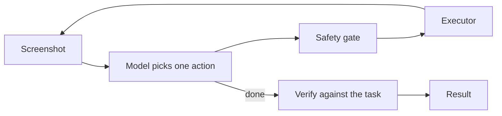
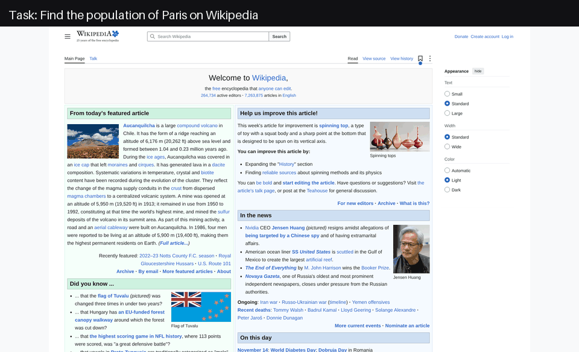

<div align="center">

# Operon

**A vision-first computer-use agent for the browser and the desktop.**

Operon sees only pixels. It reads the screen, picks a coordinate action, runs it and checks
the result. No DOM, no selectors, no accessibility tree.

[](https://github.com/vickey-kapoor/Operon/actions/workflows/ci.yml)
[](LICENSE)
[](https://www.python.org/downloads/)
[](https://operon-evals.vercel.app)

</div>

## Highlights

- **Pixels only.** Every action targets screen coordinates, so the same agent drives web
  pages and native Windows apps.
- **Gemini computer use.** Every run uses Gemini 3.5 Flash, which has computer use built in.
  Other models will come back through a simpler model onboarding (see the roadmap).
- **Two harnesses.** The full harness (Gemini's default) puts rules, guards, a per-step verifier
  and recovery around the model; the thin harness lets the model make every decision.
- **Safety around the loop.** A file guard and step budget on every run, and a trust gate (on
  by default) that blocks or asks a human before risky actions.
- **Measured.** Browser, Desktop and Hybrid benchmarks graded from app and machine state, each
  in both harnesses, on a frozen task set (Season 1), plus safety, grounding and cost tracking
  on an [eval dashboard](https://operon-evals.vercel.app).

## How it works



One loop serves both environments. The API drives it one step at a time, so a run can be
paused, resumed or handed to a human between steps. See [architecture](docs/architecture.md).

## Quick start (5 minutes)

You need Python 3.14+ and a free [Gemini API key](https://aistudio.google.com/apikey).

**1. Install** (about a minute) from [PyPI](https://pypi.org/project/operon-agent/):

```bash
python -m venv .venv && source .venv/bin/activate   # Windows: .venv\Scripts\Activate.ps1
pip install operon-agent
```

To work on Operon itself, clone the repo and `pip install -e .` instead.

> [!TIP]
> If Windows blocks `operon.exe` or `pip.exe` (Smart App Control), run the same commands through
> Python: `python -m pip install operon-agent`, then `python -m operon.cli setup` and
> `python -m operon.cli run "..."`.

**2. Set up** (about two minutes): paste your key when asked. `operon setup` checks it with
Gemini, saves it to `~/.operon` (readable only by you), installs Chromium and runs a self-check.

```bash
operon setup
```

It ends with `Ready.` If a line says `FAIL`, it tells you what to fix; run `operon setup` again.

**3. Run a task** (about a minute):

```bash
operon run "Find the population of Paris on Wikipedia" --url https://en.wikipedia.org
```

A browser window opens and Operon works through the task from screenshots alone, printing each
step. Before a risky action (placing an order, a payment, deleting an account), it stops and asks:
`y` to approve, `n` to decline, `t` to take over. Ctrl+C takes over at any time. It ends with a
short report of what it did.



That run took 2 model steps and 23 seconds; a fresh PyPI install on Windows did it in 5 steps and 88 seconds. A task like this costs a few cents of Gemini calls on your key.

**Next:** `operon serve` prints a link to a local task page, where you type tasks, watch them
live, approve steps and take over with your own mouse. Add `--desktop` to `operon run` to drive
Windows apps instead of the browser (it moves your real mouse and keyboard). More in the
[API and task page guide](docs/api.md#task-page-and-operon-run).

Or, with `operon serve` running, give it a task over HTTP:

```bash
curl -X POST http://127.0.0.1:8080/run-task \
  -H 'Content-Type: application/json' \
  -H "X-API-Key: $(cat ~/.operon/api-key)"   # .var/api-key in a source checkout \
  -d '{"intent": "Search Wikipedia for Alan Turing and open his article", "start_url": "https://www.wikipedia.org"}'
```

> [!WARNING]
> Desktop runs control your real mouse and keyboard. Use a machine you can spare, or a VM.
> The trust gate (`OPERON_TRUST_GATE`, on by default) pauses for approval before risky actions;
> set `OPERON_TRUST_ALLOW_DOMAINS` to pin browser runs to the sites you expect
> ([configuration](docs/configuration.md)). The API requires the key it generates in
> `~/.operon/api-key` (`.var/api-key` in a source checkout), or one from `API_KEYS`.

## Status and roadmap

Operon runs browser, desktop and hybrid (desktop plus browser) tasks with Gemini computer use.
On the Season 1 core sets Gemini scores 9 or 10 of 10 in most cells, so the next step
is harder tasks (Season 2), then an architecture in line with today's leading computer-use
agents: a simple way to run a task, typed shell and file tools beside the GUI, isolated and
parallel run environments, a grounding slot and fewer steps. A Python SDK release comes last.
See the [roadmap](docs/roadmap.md) for what has been built, where things stand and what is next.

## Documentation

| Topic | |
|---|---|
| [Roadmap](docs/roadmap.md) | What has been built, the current results, and what comes next |
| [Configuration](docs/configuration.md) | Model keys, backends, harness profiles, every setting |
| [HTTP API](docs/api.md) | Routes for browser and desktop runs, the live stream, auth |
| [Evaluation](docs/evaluation.md) | Latest results, benchmark suites, `/bench` PR commands, cost caps, dashboard |
| [Architecture](docs/architecture.md) | The control loop, backends, policy, verification and recovery |
| [Cost](docs/cost.md) | What a run costs and how to cut it |
| [Azure desktop runner](docs/azure-desktop-runner.md) | Running the desktop benchmark on a cloud Windows VM |
| [Cloud computer](docs/azure-linux-computer.md) | Operon on its own Azure Linux VM, watched live on the task page (`operon cloud`) |
| [Reports](docs/reports/) | Benchmark write-ups, including the [Season 1 grid](docs/reports/season-1-grid.md) |
| [PRD](docs/PRD.md) and [RFCs](docs/rfcs/) | Product context and design proposals |

## Development

```bash
pip install -e ".[dev]"                                   # editable install with test tools
GEMINI_API_KEY=fake-test-key python -m pytest tests -q   # offline, no browser, under a minute
ruff check src tests evals --select E,F,W,I --ignore E501
```

See [CONTRIBUTING.md](CONTRIBUTING.md) for conventions and how to report agent failures.

## License

[Apache 2.0](LICENSE)
