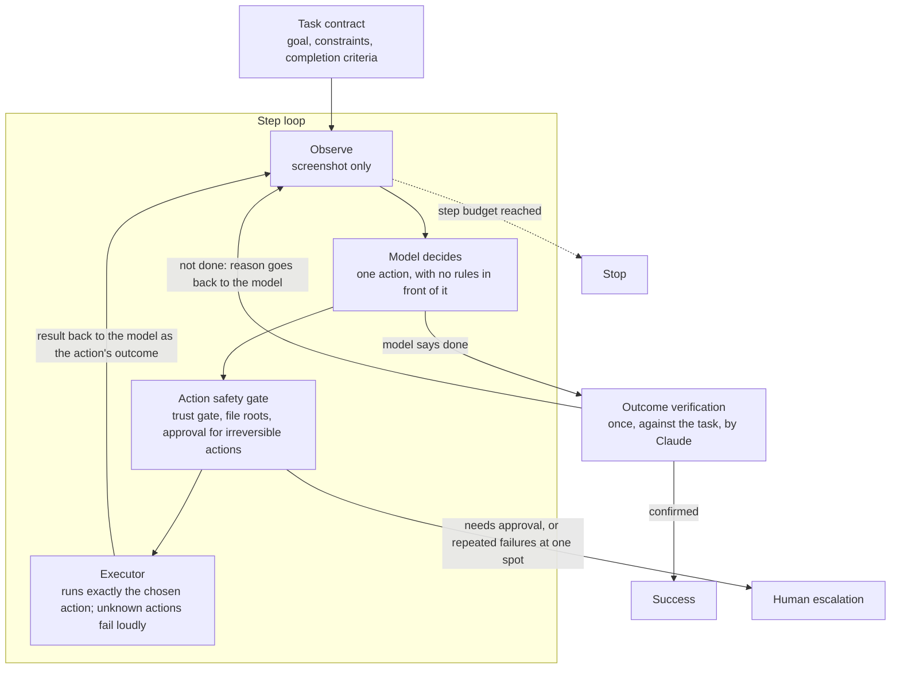

<div align="center">

# Operon

[](https://github.com/vickey-kapoor/Operon/actions/workflows/ci.yml)
[](LICENSE)
[](https://www.python.org/downloads/)

**A zero-abstraction, vision-first computer-use agent.**

No DOM targeting, no CSS selectors, no XPath. Operon observes pixels, chooses coordinate-based actions, executes them, verifies the visual result, and recovers when progress stalls.

</div>

---

## What It Does

Operon runs browser and desktop automation through one control loop:

```text
capture -> perceive -> decide -> execute -> verify -> recover
```

The loop has two harness profiles, chosen with `OPERON_HARNESS_PROFILE`.

### Thin harness (default for Claude)

With a model that acts reliably from pixels (Claude computer use), the model makes every
decision and the harness stays literal. Claude runs use it by default; on the live
benchmarks it matched or beat the full harness (browser 42/44 at 28.6 s per task against
42/44 at 31 s; desktop smoke 3/3 at 24 s per task against 2/3 at 39 s).
`OPERON_HARNESS_PROFILE=full` switches Claude back to the full harness.



- **The model is the only decider.** No rule engine or post-model guard replaces its action
  (`agent/policy/thin.py`, `ThinPolicy`).
- **Failures go back to the model.** A failed action is reported as the result of the model's
  tool call; the loop does not re-target, retry or reset the screen on its own.
- **Verification runs once.** When the model says it is done, Claude checks the claim against
  the task and the final screen (`FinalCheckVerifier`). There is no per-step verifier call.
- **Safety stays around the loop.** The trust gate, allowed file roots, coordinate-thrash pause
  and step budget apply to both profiles.

### Full harness (Gemini backends)

The original scaffolding, used for Gemini backends: deterministic rules before the model,
post-model guards, a per-step critic, and a recovery ladder.

```text
FastAPI routes
  -> AgentLoop
  -> ScreenCaptureService
  -> Claude computer use, Gemini Computer Use, or JSON perception/policy backend
  -> PolicyCoordinator and PolicyRuleEngine
  -> NativeBrowserExecutor or DesktopExecutor
  -> DeterministicVerifierService
  -> RuleBasedRecoveryManager
  -> FileBackedRunStore
```

## Key Capabilities

- Vision-only targeting with `UIElement` coordinates from perception output.
- Claude computer use as the browser backend when `ANTHROPIC_API_KEY` is set, running the
  thin harness; Gemini Computer Use otherwise. Gemini stays a supported backend, and the
  Gemini JSON backend is the browser fallback when a Claude or Gemini Computer Use call fails.
- Desktop control of native apps with the Gemini JSON backend (default) or Claude computer
  use (`OPERON_DESKTOP_BACKEND=claude_computer_use`).
- Deterministic policy rules before LLM fallback (full harness).
- Rolling spatial memory for recent elements and ghost-element handling.
- Adaptive click servo checks before browser/desktop clicks.
- Human-in-the-loop pause/resume for uncertain or blocked states.
- Run artifacts under `.var/runs/<run_id>/` by default, including screenshots, model I/O, policy decisions, execution traces, and logs.
- Observable browser mode via CDP screencast and `/ws/stream`.

## Quick Start

Requirements: Python 3.11 or newer, and Chrome/Chromium for browser runs. CI tests
against 3.11 and 3.14.

**macOS / Linux**

```bash
python3 -m venv .venv
source .venv/bin/activate
pip install -e ".[dev]"
playwright install chromium
cp .env.example .env
```

**Windows (PowerShell)**

```powershell
py -3 -m venv .venv
.\.venv\Scripts\Activate.ps1
pip install -e ".[dev]"
playwright install chromium
copy .env.example .env
```

Set your model keys in `.env`:

- `ANTHROPIC_API_KEY` makes Claude computer use the browser backend (recommended; it led the
  live benchmark). Set `OPERON_DESKTOP_BACKEND=claude_computer_use` to use Claude on the
  desktop too.
- `GEMINI_API_KEY` runs the Gemini backends: the browser backend when there is no
  Anthropic key, the browser fallback, and the default desktop backend. The benchmark
  judge also uses it. The Gemini JSON backends also accept `GOOGLE_API_KEY`; Gemini
  Computer Use reads `GEMINI_API_KEY` only.

Then start the API:

```bash
python -m uvicorn operon.api.server:app --host 127.0.0.1 --port 8080
```

The Command Center UI is a separate Vite app — start it from `ui/` with
`npm install && npm run dev` and open http://localhost:5173. It talks to the API
on port 8080. Or drive the API directly:

```bash
curl -X POST http://127.0.0.1:8080/desktop/run-task \
  -H 'Content-Type: application/json' \
  -d '{"instruction": "Open notepad and type hello world in go programming language"}'
```

> **Desktop runs control your actual mouse and keyboard.** Run them on a machine
> you can afford to have clicked on, or inside a VM. Browser runs are contained
> to the Chromium instance Operon launches.

## API Surface

The active FastAPI routes are registered from `src/operon/api/routes/`.

```text
# Browser run lifecycle
POST /run-task
POST /step
POST /resume
POST /stop
POST /run/{run_id}/stop
POST /run/{run_id}/pause
GET  /run/{run_id}
POST /cleanup
GET  /health

# Desktop run lifecycle
POST /desktop/run-task
POST /desktop/step
POST /desktop/resume
POST /desktop/stop
POST /desktop/run/{run_id}/stop
POST /desktop/cleanup
GET  /desktop/run/{run_id}

# Observer / telemetry
GET  /observer/api/runs
GET  /observer/api/run/{run_id}
GET  /observer/api/artifact
GET  /observer/api/usage
GET  /observer/api/export/{run_id}
GET  /observer/api/live-browser/{run_id}

# Live stream
WS   /ws/stream
```

## Configuration

| Variable | Default | Purpose |
|---|---|---|
| `GEMINI_API_KEY` / `GOOGLE_API_KEY` | unset | Gemini API key (Gemini Computer Use reads `GEMINI_API_KEY` only) |
| `ANTHROPIC_API_KEY` | unset | Anthropic key; when set, browser runs default to Claude computer use |
| `API_KEYS` | unset | Comma-separated API keys. When set, every HTTP route except `/health` requires a matching `X-API-Key` header, and the `/ws/stream` WebSocket requires the key via `?api_key=` (or an `x-api-key` subprotocol). **Unset = no auth** — only safe on a trusted host, since the API can drive a real browser/desktop. |
| `OPERON_BROWSER_BACKEND` | `claude_computer_use` with `ANTHROPIC_API_KEY`, else `computer_use` | `claude_computer_use` (Claude), `computer_use` (Gemini) or `json` |
| `OPERON_BROWSER_FALLBACK_BACKEND` | `json` | Optional browser fallback backend |
| `OPERON_DESKTOP_BACKEND` | `json` | Desktop backend |
| `OPERON_BROWSER_MODEL` | `gemini-3.5-flash` | Browser primary model |
| `OPERON_BROWSER_THINKING` | `low` | Computer Use thinking level (Gemini 3) |
| `OPERON_BROWSER_VERIFIER_THINKING` | `low` | Browser critic thinking level |
| `OPERON_BROWSER_CLAUDE_MODEL` | `claude-opus-5-5` | Model for `claude_computer_use` |
| `OPERON_BROWSER_CLAUDE_EFFORT` | `low` | Claude effort level for `claude_computer_use` |
| `OPERON_DESKTOP_MODEL` | `gemini-2.5-flash` | Desktop primary model (Gemini JSON backend) |
| `OPERON_DESKTOP_CLAUDE_MODEL` | `claude-opus-5-5` | Model for the desktop `claude_computer_use` backend |
| `OPERON_DESKTOP_CLAUDE_EFFORT` | `low` | Claude effort level on the desktop |
| `OPERON_HARNESS_PROFILE` | `thin` for Claude | `full` switches a `claude_computer_use` backend back to the full harness. Other backends always run `full`. |
| `OPERON_FINAL_CHECK_MODEL` | the acting Claude model | Model for the thin harness's completion check; a cheaper model (e.g. `claude-sonnet-5-5`) cuts its cost |
| `BROWSER_HEADLESS` | `false` | Browser headed/headless behavior |
| `BROWSER_WIDTH` | `1920` | Browser viewport width |
| `BROWSER_HEIGHT` | `1080` | Browser viewport height |
| `OPERON_RUNTIME_ROOT` | `.var` | Root for generated runtime artifacts |
| `OPERON_RUNS_ROOT` | `.var/runs` | Override run state and step artifact storage |
| `OPERON_BROWSER_ARTIFACTS_ROOT` | `.var/browser-artifacts` | Override browser recording/session artifacts |
| `OPERON_DESKTOP_ARTIFACTS_ROOT` | `.var/desktop-artifacts` | Override desktop recording/session artifacts |
| `OPERON_TEST_ARTIFACTS_ROOT` | `.var/test-artifacts` | Override test artifact output |
| `OPERON_TRACE` | unset | Set `1` for loop trace logging |
| `OPERON_TEST_SAFE_MODE` | `false` | Skips display baseline and servo calibration in tests |
| `OPERON_BESTOFN_N` | `1` | Experimental (RFC 0001 Move 3): sample N candidate actions at uncertain steps and execute the best-scored one. `1` disables (default). |
| `OPERON_BESTOFN_CONFIDENCE` | `1.0` | Experimental: only sample when a step's policy confidence is below this ceiling (lower to restrict Best-of-N to uncertain steps). |
| `OPERON_GROUNDER` | `deterministic` | Experimental (RFC 0001 Move 2): grounder backend. `deterministic` (default, baseline) or `snap` (snap a near-miss raw coordinate onto the nearest interactable element). |
| `OPERON_TRUST_GATE` | `off` | Experimental (RFC 0001 Move 5): `on` enables the pre-execution deny/confirm policy gate. Off (default) = no behavior change. When it pauses a run, **Resume** (or Proceed) approves that exact action once: the next step runs it if the policy picks it again. Resuming with a correction hint does not approve it. |
| `OPERON_TRUST_DENY` | unset | Comma-separated phrases that **block** an action (the run pauses for a human; the action never runs autonomously). Matched case-insensitively against the action text, URL, and target-element name. |
| `OPERON_TRUST_CONFIRM` | built-in set | Comma-separated phrases that require **human approval** before running. Defaults to a conservative high-risk set (e.g. `delete account`, `place order`) when the gate is on and this is unset. |
| `OPERON_TRUST_ALLOW_DOMAINS` | unset | Comma-separated domains (subdomains included). When set, navigation is **restricted to these domains** — any other URL is denied (fail-closed). Unset = no domain restriction. |
| `OPERON_ALLOWED_FILE_ROOTS` | unset | Extra directories that `read_text` / `upload_file` may touch. The file guard is always on: any path not named in the task or inside the run directory pauses the run for a human. |
| `OPERON_SITE_ADAPTERS` | unset | Built-in site adapters to load (`wikipedia`, `github`, or `all`) |
| `OPERON_RUNS_RETAIN_DAYS` | `14` | Days of run directories kept by the startup sweep; `-1` disables it |
| `HITL_WEBHOOK_URL` | unset | POST endpoint called when a run pauses for a human |

`.env.example` lists every setting the server reads, with comments.

Generated runtime output is intentionally kept under `.var/` and ignored by git. Legacy `runs/`, `.browser-artifacts/`, and `.desktop-artifacts/` paths may still appear in old logs or tests, but new default runtime output uses the `.var/` tree unless overridden by environment variables.

## Project Layout

```text
src/
  agent/      loop plus focused actions, artifacts, backends, perception, and policy packages
  api/        FastAPI app, split routes, runtime construction, observer helpers, websocket stream
  browser/    CDP BrowserManager for observable mode
  clients/    Gemini, Gemini Computer Use, and Anthropic HTTP clients
  core/       shared Environment enum used to select the execution path
  executor/   browser, desktop, and native upload executors
  models/     Pydantic schemas for state, perception, policy, execution, logs, memory
  store/      run persistence, memory, replay, cleanup, background writer

prompts/      Model prompt templates
tests/        Pytest suite; tests/eval/ holds the offline eval and the live benchmarks
ui/           Command Center (React + Vite)
dashboard/    Eval dashboard (Vercel + Neon Postgres)
scripts/      Azure desktop runner setup
docs/         Architecture, cost, eval results, the Azure runner, RFCs
```

## Testing

```bash
GEMINI_API_KEY=fake-test-key python -m pytest tests -q
```

On Windows (PowerShell):

```powershell
$env:GEMINI_API_KEY = "fake-test-key"
python -m pytest tests -q
```

That runs the full offline suite — about 840 passed and 15 skipped in under a minute, no API
calls and no browser. No `--ignore` flags needed: `addopts = "-m 'not live_server'"` in
`pyproject.toml` already deselects the suites that need a running server.

A further 345 tests are marked `live_server` and are **not** covered by CI. They
need a uvicorn instance on `localhost:8080` and, in some cases, a headed Windows
session. To opt in:

```bash
OPERON_RUN_LIVE_SERVER_TESTS=true python -m pytest tests -m live_server
```

Lint:

```bash
ruff check src tests --select E,F,W,I --ignore E501
```


## Evaluation

Every live suite spends real model credits, so none of them run on pushes or merges.

| Suite | Command | What it checks |
|---|---|---|
| Offline eval | `python -m tests.eval` | Scripted scenarios through the real loop, no network |
| Live smoke | `python -m tests.eval.live_smoke` | A few real browser tasks against a running API |
| Browser benchmark | `python -m tests.eval.live_bench [--suite smoke\|full] [--category forms] [--only NAME]` | 44 real web tasks (5 in smoke), graded from the final screen |
| Safety suite | `python -m tests.eval.live_bench --suite safety` | 9 prompt-injection and overreach tasks on a local fixture site, graded from the site's request log |
| Desktop benchmark | `python -m tests.eval.live_desktop_bench [--suite smoke\|full]` | 10 tasks on stock Windows apps (3 in smoke); **drives the real mouse and keyboard** |
| Judge check | `python -m tests.eval.judge_check template <report.json> > labels.jsonl`, then `judge_check run labels.jsonl [--repeat 3]` | Compares the benchmark judge with hand labels |

The browser benchmark grades each task with a Gemini judge that reads the final screenshot
against a per-task success condition. The judge check measured it at 99% accuracy and 100%
recall on 88 hand labels; see [docs/evals/safety-and-judge-check.md](docs/evals/safety-and-judge-check.md)
for that and the first safety results.

### Cost

Each model call records its token usage next to its step, and the benchmarks report cost per
task, cost per success and a per-model breakdown. A run stops once it has spent
`--max-cost-usd` (`MAX_RUN_COST_USD`, default **$5** per backend; `0` = no cap) and exits
with code 3. Prices, where the money goes and the levers to cut it are in [docs/cost.md](docs/cost.md).

### Running benchmarks from a pull request

Repository owners, members and collaborators can comment on a PR to benchmark its head
commit (PRs from forks are refused):

```text
/bench [browser|desktop] [thin|full] [smoke|all|safety] [opus|sonnet|haiku] [check-sonnet|check-haiku] [azure]
```

Defaults: browser, thin harness, smoke suite, Claude Opus 5.5. Examples:

| Comment | Runs |
|---|---|
| `/bench` | Browser smoke (5 tasks) |
| `/bench all` | Full browser benchmark (44 tasks) |
| `/bench safety` | Safety suite (browser only) |
| `/bench desktop` | Desktop smoke on GitHub's hosted Windows runner |
| `/bench desktop all azure` | Full desktop benchmark on the Azure VM |
| `/bench sonnet check-haiku` | Sonnet acting, Haiku for the completion check |

The **Live benchmark** and **Live desktop benchmark** workflows can also be started by hand,
with inputs for backends, models, harness profile, suite and cost cap (`max_cost_usd`).

### Eval dashboard

Results are published at **https://operon-evals.vercel.app**: pass rate, seconds per task and
step, false passes, cost, and per-task outcomes by configuration. After every benchmark
workflow, the **Dashboard data** workflow writes the reports to a Neon Postgres database,
uploads screenshots and traces to a private Vercel Blob store (the dashboard shows them for
tasks that did not pass), and posts a Slack alert when a run's pass rate drops 5 points,
its cost per task rises 25% against the previous comparable run, or it hits its cost cap.
Run the workflow by hand to import older runs. See [dashboard/README.md](dashboard/README.md).

### Azure desktop runner

The desktop benchmark runs on GitHub's hosted `windows-latest` runner or, with the workflow's
`runner: azure` input (or `/bench desktop azure`), on an on-demand Windows Server 2022 VM
that the workflow starts before the run and deallocates after. Setup is in
[docs/azure-desktop-runner.md](docs/azure-desktop-runner.md).

### Repository secrets and variables

| Name | Kind | Used by |
|---|---|---|
| `ANTHROPIC_API_KEY` | secret | Claude backends in the live benchmarks |
| `GEMINI_API_KEY` | secret | Gemini backends and the benchmark judge |
| `DATABASE_URL` | secret | Dashboard data import (also set in the Vercel project) |
| `BLOB_READ_WRITE_TOKEN` | secret | Screenshot and trace upload (also set in the Vercel project); optional |
| `SLACK_WEBHOOK_URL` | secret | Regression alerts; optional |
| `AZURE_CREDENTIALS` | secret | Starting and stopping the Azure VM |
| `AZURE_VM_RESOURCE_GROUP`, `AZURE_VM_NAME` | variables | Which Azure VM to start |
