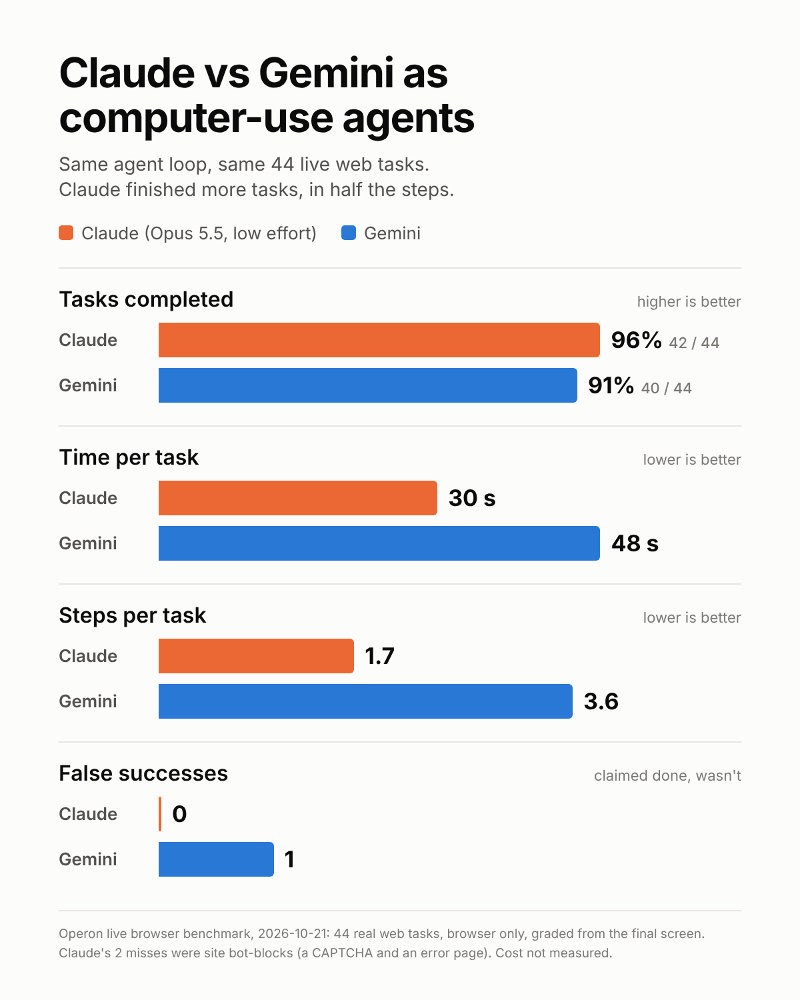
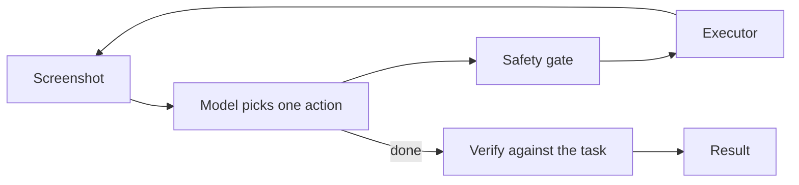

<div align="center">

# Operon

**A vision-first computer-use agent for the browser and the desktop.**

Operon sees only pixels. It reads the screen, picks a coordinate action, runs it and checks
the result. No DOM, no selectors, no accessibility tree.

[](https://github.com/vickey-kapoor/Operon/actions/workflows/ci.yml)
[](LICENSE)
[](https://www.python.org/downloads/)
[](https://operon-evals.vercel.app)

</div>

<p align="center">
  
</p>

## Highlights

- **Pixels only.** Every action targets screen coordinates, so the same agent drives web
  pages and native Windows apps.
- **Claude or Gemini.** Claude computer use is the default when an Anthropic key is set;
  Gemini is fully supported and serves as the fallback.
- **A thin harness for strong models.** Claude makes every decision and checks its own
  result once at the end; Gemini gets rules, guards and recovery around it.
- **Safety around the loop.** A file guard and step budget on every run, plus an optional
  trust gate that blocks or asks a human before risky actions.
- **Measured.** A 44-task live web benchmark, a prompt-injection suite, local test apps and a
  Windows desktop suite, with cost per task, on an [eval dashboard](https://operon-evals.vercel.app).

## How it works



One loop serves both environments. The API drives it one step at a time, so a run can be
paused, resumed or handed to a human between steps. See [architecture](docs/architecture.md).

## Quick start

Requires Python 3.11+ and Chromium.

```bash
python -m venv .venv && source .venv/bin/activate   # Windows: .venv\Scripts\Activate.ps1
pip install -e ".[dev]"
playwright install chromium
cp .env.example .env    # then set ANTHROPIC_API_KEY and/or GEMINI_API_KEY
python -m uvicorn operon.api.server:app --host 127.0.0.1 --port 8080
```

Give it a task:

```bash
curl -X POST http://127.0.0.1:8080/run-task \
  -H 'Content-Type: application/json' \
  -d '{"intent": "Search Wikipedia for Alan Turing and open his article", "start_url": "https://www.wikipedia.org"}'
```

Or run the Command Center UI from `ui/` (`npm install && npm run dev`, then open
http://localhost:5173).

> [!WARNING]
> Desktop runs control your real mouse and keyboard. Use a machine you can spare, or a VM.
> Set `API_KEYS` before exposing the API on a network.

## Documentation

| Topic | |
|---|---|
| [Configuration](docs/configuration.md) | Model keys, backends, harness profiles, every setting |
| [HTTP API](docs/api.md) | Routes for browser and desktop runs, the live stream, auth |
| [Evaluation](docs/evaluation.md) | Latest results, benchmark suites, `/bench` PR commands, cost caps, dashboard |
| [Architecture](docs/architecture.md) | The control loop, backends, policy, verification and recovery |
| [Cost](docs/cost.md) | What a run costs and how to cut it |
| [Azure desktop runner](docs/azure-desktop-runner.md) | Running the desktop benchmark on a cloud Windows VM |

## Development

```bash
GEMINI_API_KEY=fake-test-key python -m pytest tests -q   # offline, no browser, under a minute
ruff check src tests --select E,F,W,I --ignore E501
```

See [CONTRIBUTING.md](CONTRIBUTING.md) for conventions and how to report agent failures.

## License

[Apache 2.0](LICENSE)
